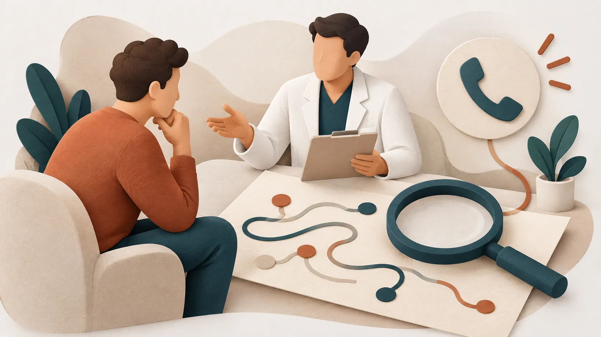
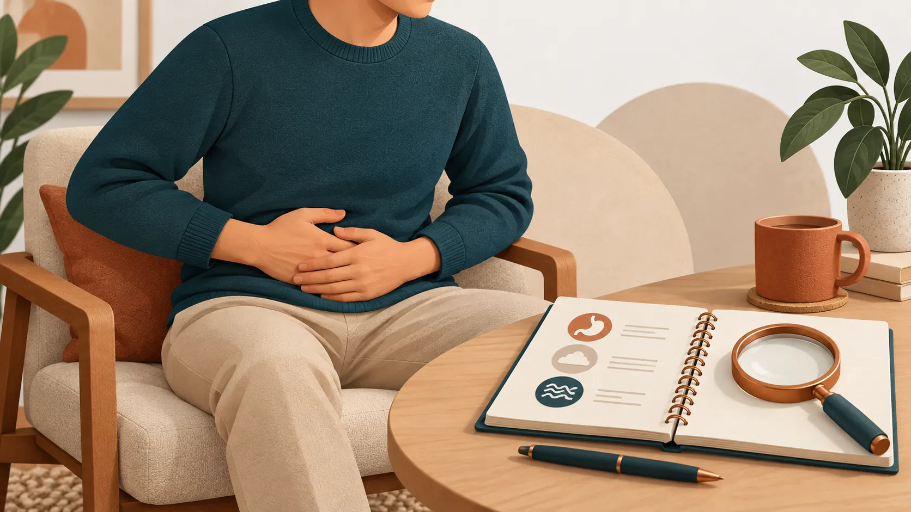
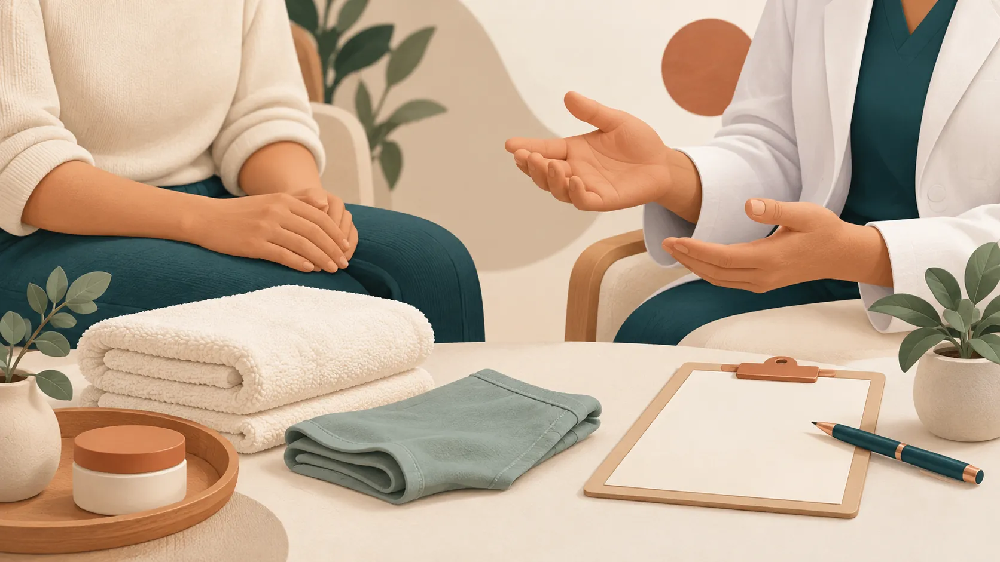
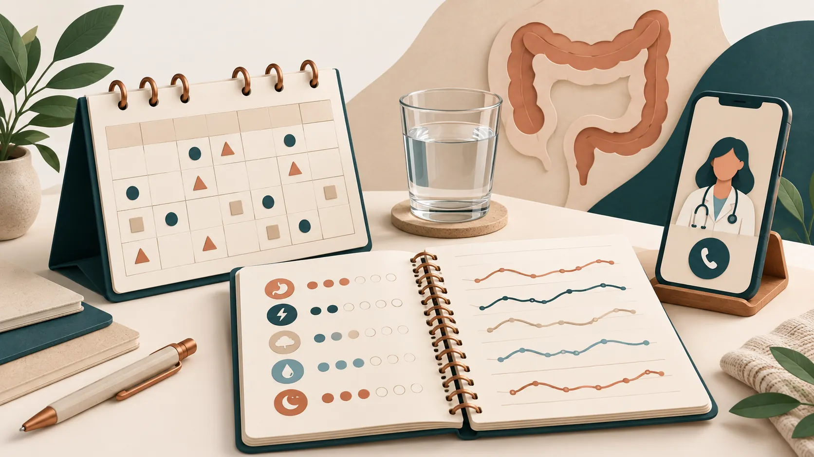
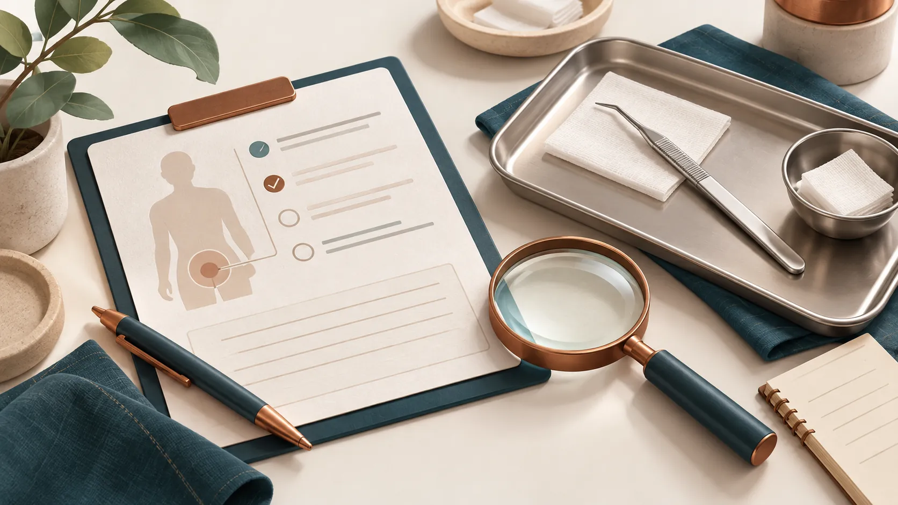
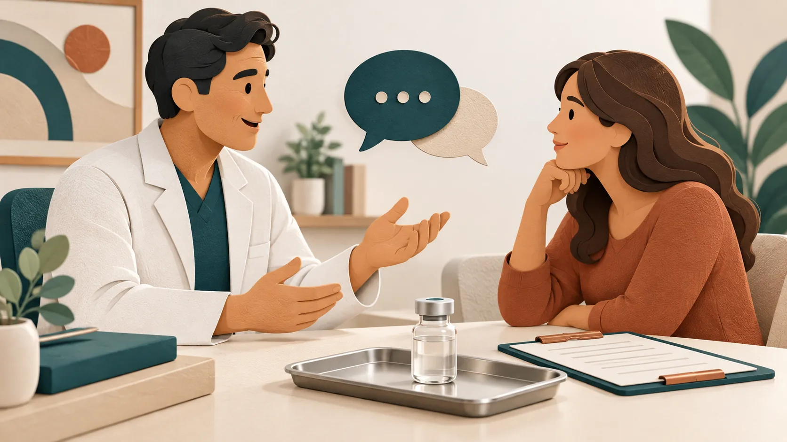
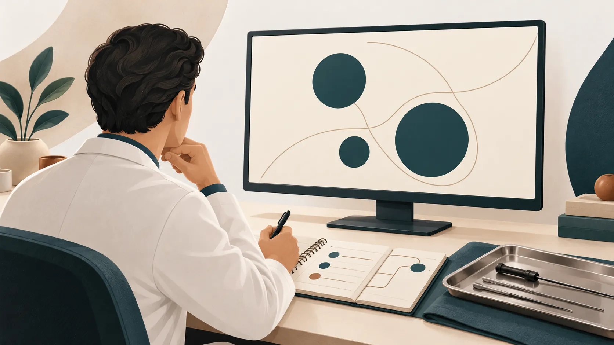
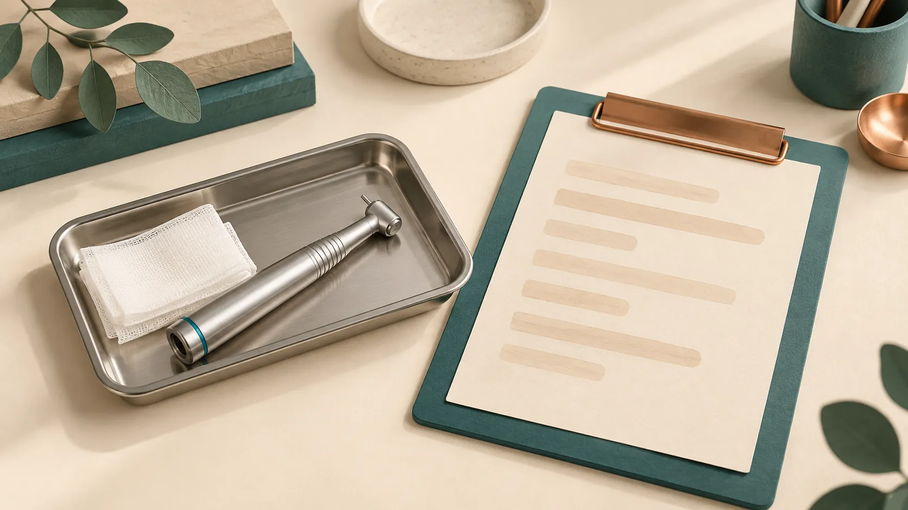

# Revisão das novas ilustrações editoriais — 13/10/2026

23 arquivos gerados com a ferramenta built-in image_gen: 16 artigos sem imagem e sete capas para diferenciar cards. Os 40 artigos agora têm capas distintas; diagramas originais podem continuar repetidos no corpo quando explicam o mesmo tema.

Todas as novas imagens são ilustrações editoriais geradas com IA, não fotografias de pacientes, do consultório ou de procedimentos reais. Símbolos e instrumentos são conceituais: não comprovam anatomia, diagnóstico, técnica, equipamento ou resultado clínico. Não há afirmação de aprovação médica nesta entrega.

Antes de publicar, a Dra. Dayara deve revisar os textos completos, conferir associação imagem/tema, alt, legendas, símbolos e adequação visual, além da procedência e fidelidade dos diagramas anteriores. Ajustes de imagens geradas são possíveis. As pessoas ilustradas não representam a médica ou seus pacientes.

Manifest completo (prompts, dimensões, arquivos, SHA-256 e fonte original): [blog-generated-images-manifest.json](blog-generated-images-manifest.json). Originais fora de public; WebP final otimizado sem recorte/redimensionamento, qualidade80.

| Artigo | Uso novo | Arquivo |
| --- | --- | --- |
| Como encontrar um coloproctologista em Campo Grande (MS)? | Imagem de corpo e card/SEO | [Ver imagem](../public/assets/blog/capa-como-encontrar-coloproctologista-campo-grande-ms.webp) |
| Hemorroida tem cura ou passa sozinha? O que muda com o tratamento | Imagem de corpo e card/SEO | [Ver imagem](../public/assets/blog/capa-hemorroida-tem-cura-ou-passa-sozinha.webp) |
| Ligadura elástica dói? O que esperar antes e depois | Imagem de corpo e card/SEO | [Ver imagem](../public/assets/blog/capa-ligadura-elastica-doi-recuperacao-cuidados.webp) |
| Primeira consulta com coloproctologista: o que esperar | Imagem de corpo e card/SEO | [Ver imagem](../public/assets/blog/capa-primeira-consulta-coloproctologista-como-se-preparar.webp) |
| Cisto Pilonidal: Sinais, Diagnóstico e Tratamento | Imagem de corpo e card/SEO | [Ver imagem](../public/assets/blog/capa-cisto-pilonidal-sinais-diagnostico.webp) |
| HPV Anal: Como Identificar e Tratar | Capa de card/SEO; diagrama do corpo preservado | [Ver imagem](../public/assets/blog/capa-hpv-anal-identificar-tratar.webp) |
| Fístula Anal: O Que É, Sintomas e Como Tratar | Capa de card/SEO; diagrama do corpo preservado | [Ver imagem](../public/assets/blog/capa-fistula-anal-o-que-e-sintomas.webp) |
| Doença Hemorroidária: Sintomas, Graus e Formas de Tratamento | Imagem de corpo e card/SEO | [Ver imagem](../public/assets/blog/capa-doenca-hemorroidaria-sintomas-graus.webp) |
| Doenças Inflamatórias Intestinais: Quando Suspeitar de Crohn ou Retocolite | Imagem de corpo e card/SEO | [Ver imagem](../public/assets/blog/capa-doencas-inflamatorias-intestinais-crohn-retocolite.webp) |
| Histórico de Crohn, Retocolite ou Casos na Família: Quando Fazer Acompanhamento com Coloproctologista | Imagem de corpo e card/SEO | [Ver imagem](../public/assets/blog/capa-historico-crohn-retocolite-familia-acompanhamento-coloproctologista.webp) |
| Hidradenite Supurativa: Sintomas, Impacto e Tratamento | Imagem de corpo e card/SEO | [Ver imagem](../public/assets/blog/capa-hidradenite-supurativa-sintomas-tratamento.webp) |
| Síndrome do Intestino Irritável: Sintomas e Manejo | Imagem de corpo e card/SEO | [Ver imagem](../public/assets/blog/capa-sindrome-intestino-irritavel-sintomas-manejo.webp) |
| Diarreia Crônica: Causas e Sinais de Alerta | Imagem de corpo e card/SEO | [Ver imagem](../public/assets/blog/capa-diarreia-cronica-causas-sinais-alerta.webp) |
| Constipação Intestinal: Quando é Preciso Investigar | Imagem de corpo e card/SEO | [Ver imagem](../public/assets/blog/capa-constipacao-intestinal-quando-investigar.webp) |
| Alterações no Hábito Intestinal: Quando a Mudança Merece Avaliação Médica | Imagem de corpo e card/SEO | [Ver imagem](../public/assets/blog/capa-alteracoes-habito-intestinal-quando-avaliar.webp) |
| Remoção de plicoma anal com laser de CO2: como funciona e quando vale a pena | Capa de card/SEO; diagrama do corpo preservado | [Ver imagem](../public/assets/blog/capa-plicoma-anal-laser-co2.webp) |
| Fístula anal com VAAFT e FiLaC: vídeo para mapear, laser para tratar | Capa de card/SEO; diagrama do corpo preservado | [Ver imagem](../public/assets/blog/capa-fistula-anal-laser-vaaft-filac.webp) |
| Toxina botulínica para fissura anal: como quebra o ciclo da dor | Imagem de corpo e card/SEO | [Ver imagem](../public/assets/blog/capa-toxina-botulinica-fissura-anal.webp) |
| Caroço, verruga ou ferida na região anal: como saber o que é | Capa de card/SEO; diagrama do corpo preservado | [Ver imagem](../public/assets/blog/capa-lesoes-verrugas-nodulos-regiao-anal-o-que-observar.webp) |
| Cisto pilonidal com EPSiT e laser: por dentro, sem ferida aberta | Capa de card/SEO; diagrama do corpo preservado | [Ver imagem](../public/assets/blog/capa-cisto-pilonidal-laser-epsit.webp) |
| Hemorroidectomia com laser de CO2: o que muda quando o corte é feito a laser | Capa de card/SEO; diagrama do corpo preservado | [Ver imagem](../public/assets/blog/capa-hemorroidectomia-laser-co2.webp) |
| Dor ao Evacuar: O Que Pode Ser e Quando Investigar | Imagem de corpo e card/SEO | [Ver imagem](../public/assets/blog/capa-dor-ao-evacuar-quando-investigar.webp) |
| Sangramento Anal ou Dor: Quando Procurar uma Coloproctologista | Imagem de corpo e card/SEO | [Ver imagem](../public/assets/blog/capa-sangramento-anal-dor-quando-procurar-coloproctologista-v2.webp) |

## Prévia das imagens

### Como encontrar um coloproctologista em Campo Grande (MS)?

### Hemorroida tem cura ou passa sozinha? O que muda com o tratamento

### Ligadura elástica dói? O que esperar antes e depois

### Primeira consulta com coloproctologista: o que esperar

### Cisto Pilonidal: Sinais, Diagnóstico e Tratamento

### HPV Anal: Como Identificar e Tratar

### Fístula Anal: O Que É, Sintomas e Como Tratar

### Doença Hemorroidária: Sintomas, Graus e Formas de Tratamento

### Doenças Inflamatórias Intestinais: Quando Suspeitar de Crohn ou Retocolite

### Histórico de Crohn, Retocolite ou Casos na Família: Quando Fazer Acompanhamento com Coloproctologista

### Hidradenite Supurativa: Sintomas, Impacto e Tratamento

### Síndrome do Intestino Irritável: Sintomas e Manejo

### Diarreia Crônica: Causas e Sinais de Alerta

### Constipação Intestinal: Quando é Preciso Investigar

### Alterações no Hábito Intestinal: Quando a Mudança Merece Avaliação Médica

### Remoção de plicoma anal com laser de CO2: como funciona e quando vale a pena

### Fístula anal com VAAFT e FiLaC: vídeo para mapear, laser para tratar

### Toxina botulínica para fissura anal: como quebra o ciclo da dor

### Caroço, verruga ou ferida na região anal: como saber o que é

### Cisto pilonidal com EPSiT e laser: por dentro, sem ferida aberta

### Hemorroidectomia com laser de CO2: o que muda quando o corte é feito a laser

### Dor ao Evacuar: O Que Pode Ser e Quando Investigar

### Sangramento Anal ou Dor: Quando Procurar uma Coloproctologista

